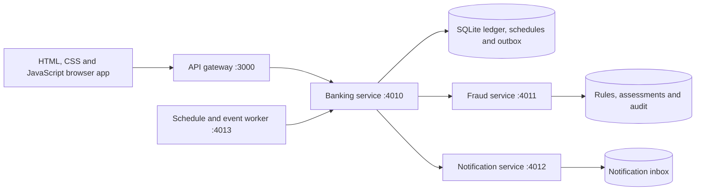

# Platform architecture

The local platform runs five Node.js processes. Docker Compose runs the same entrypoints as separate containers. Customer accounts, credentials, authorizations, and the money ledger share one transactional boundary in the banking service. Fraud evaluation and notifications have independent databases and authenticated HTTP contracts. The gateway is the only published application port.

## Service responsibilities

| Service | Entrypoint | Responsibility |
| --- | --- | --- |
| Gateway | `services/gateway.js` | Routes browser traffic, hides internal endpoints, strips service credentials supplied by external clients, and checks dependency health. |
| Banking | `app.js` | Sessions, account ownership, balance enquiries, password authorization, transfers, bill payments, scheduled instructions, statements/history data, review decisions, and the ledger/outbox. |
| Fraud | `services/fraud/server.js` | Historical features, trained model inference, configurable rules, immutable assessments, and versioned rule changes. |
| Notifications | `services/notifications/server.js` | Idempotent event consumption and per-customer notification/read state. |
| Worker | `services/worker.js` | Periodically asks the banking service to execute due instructions and deliver outstanding events. |

`npm start` generates an in-memory internal service token unless an ignored `.env` supplies one. Private services bind to loopback in native development. Compose uses a private backend network and exposes only loopback port 3000. The same source can run as one embedded banking process for isolated tests with `npm run start:banking`; the financial rules are identical.

## Money and events

Balances are integer cents. A successful internal transfer writes the source debit, recipient credit, both ledger entries, the immutable request result, and notification outbox events in one `BEGIN IMMEDIATE` transaction. Failed changes roll back together. Client request identifiers prevent duplicate execution, including when an HTTP response is lost.

Risk evaluation happens before the short money-write transaction. The ledger rechecks ownership, account state and current balance after scoring. A held transaction records its risk and lifecycle without moving funds. Independent review rechecks available funds at approval time.

The outbox is durable, with leases, bounded exponential retries and delivery state. The notification consumer deduplicates by event identifier. A crash after event consumption but before acknowledgement causes redelivery and a single visible notification. This is at-least-once delivery with idempotent effects.

Scheduled instructions retain authorization for the exact stored payment details; passwords are never stored in an instruction. Each occurrence has a stable identifier. Worker retries and concurrent ticks cannot create a second debit for that occurrence. Time is stored as UTC; customer dates and daily fraud limits use Singapore time.

## Database design and optimisation

The banking database contains users, sessions, savings accounts, transactions, request deduplication, scheduled instructions/runs, and the outbox. The fraud database contains rule configuration, change audit and cached assessments. The notification database contains recipient inbox/read state.

SQLite uses foreign keys, WAL mode and a busy timeout. Ownership/date indexes support account history; unique account numbers and request keys enforce identity and deduplication; partial indexes support unread notifications. Worker queries use bounded batches and indexed due/delivery columns. Transactions keep network operations outside their write locks.

This implementation is a single-writer ledger suitable for the project demonstration. Cloud deployment and an AWS database adapter are deferred at the user's request. An AWS migration must preserve conditional balance updates, idempotency, the outbox and maker-checker controls. DynamoDB is an option, with atomic writes across the relevant items through [`TransactWriteItems`](https://docs.aws.amazon.com/amazondynamodb/latest/developerguide/transactions.html); it is not configured or claimed as this runtime's database.

## Automated delivery

The GitHub Actions workflow runs financial/API/service tests, desktop/mobile browser checks, and a Docker Compose smoke flow. Version tags publish the tested container to GHCR. Cloud provisioning and production rollout remain deferred. The image contains no database, `.env` or hosted prototype dependencies.

The workflow follows GitHub's [Node.js testing](https://docs.github.com/en/actions/tutorials/build-and-test-code/nodejs) and [container publishing](https://docs.github.com/en/actions/tutorials/publish-packages/publish-docker-images) patterns. Compose startup uses dependency [health checks](https://docs.docker.com/compose/how-tos/startup-order/).
