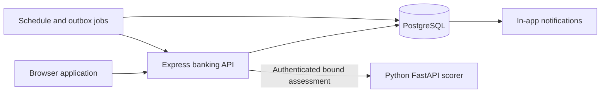

# DFT application architecture

The active application has an Express banking API, a Python FastAPI scoring process, and PostgreSQL. Financial records share one transactional database boundary. The scorer is stateless and authenticated; it cannot transfer money, change policies or mutate balances. No separate gateway, container orchestrator or deployment pipeline is part of this DFT release.

This is a digital wholesale banking project. `businesses` stores the legal customer; `users` stores authorized operators and bank staff. `accounts.business_id` links the legal owner while `user_id` retains the primary operator authorization boundary. A database trigger enforces that binding. Migration 005 adds this model without rewriting existing customer names, passwords, balances or history. No business identity is fabricated for a legacy user. New applications require independent bank review before account changes or funds movement.

`app.js` supplies HTTP routing, body limits, headers, authentication, ownership enforcement and application lifecycle. `banking/auth.js` owns credentials and sessions; `banking/ledger.js` owns financial mutations; `banking/history.js` owns snapshot reads/statements; `banking/risk.js` owns policy snapshots and scorer validation; `banking/workflows.js` owns schedules, occurrence recovery and notifications. The assistant is an independent read/draft module with no payment execution function.

## Database boundary

Versioned SQL migrations create customers, accounts, signed ledger entries, sessions, quotas, audit events, bound request keys, model assessments, fraud policies, schedules and the transactional notification outbox. Queries use positional parameters for customer input. Account numbers, request keys, schedule occurrences and settlement sequence values have database uniqueness constraints. Monetary values are integer cents with explicit supported bounds.

`db:setup` provisions PostgreSQL and separate runtime/migration roles without resetting records. The web login has no DDL or role-management privileges and cannot rewrite audit records, delete ledger entries, update recorded amounts or change opening balances. Operator/test credentials remain outside the web environment; Python receives no database or MFA encryption credentials. `db:check` checks schema provenance, runtime permissions and snapshot ledger reconciliation. See [database design and setup](database.md).

Payment submission permanently binds the customer's request key to canonical type, source and payload before awaiting Python. A persisted assessment binds the same identifiers, history summary and approved policy version. External I/O happens outside money write locks. Settlement locks the sender and affected accounts in a consistent order, rechecks authorization, funds and current blocking rules, then commits the debit/credit, immutable receipt, idempotent result, audit and outbox together. A failed transaction rolls back every financial effect.

Read dashboards, searches and statements use PostgreSQL snapshots. Statements validate stored opening provenance against completed ledger entries and the recorded balance; unexplained drift returns a conflict rather than inventing a new opening balance. `settlement_seq` gives explicit ordering independent of insertion accidents.

## Recovery and events

Schedules claim due occurrences through row locks and durable leases. Each occurrence uses a deterministic payment key. A retry after a crash reads the committed receipt instead of debiting again. Transient service failures preserve the occurrence and retry with bounded delay; permanent failures are recorded. Cancellation checks for an already committed occurrence before labelling its run cancelled. Monthly recurrence retains the original UTC day where the month permits it.

An outbox event commits in the same transaction as its banking operation. The dispatcher inserts a deduplicated in-app notification and marks the outbox event delivered in one transaction. Batches and locking permit interruption/retry; this is a durable in-app integration pattern, not an external message broker or email service.

## Security contracts

Only Express interprets explicitly trusted proxy addresses; auth uses `req.ip`. Browser writes require the correct origin and session CSRF, with same-origin entry guards for login/register. Opaque cookies hold no customer records; PostgreSQL stores only token hashes. Authenticator secrets are encrypted and recovery codes hashed. Python rejects unauthorized requests, invalid schemas and response bindings. Model failure never silently switches to an unapproved JavaScript scorer.

Infrastructure, certificates, cloud backups and release delivery are DIT responsibilities. This repository supplies the application boundaries and configuration contract without implementing those systems. Historical implementations remain excluded reference material.
