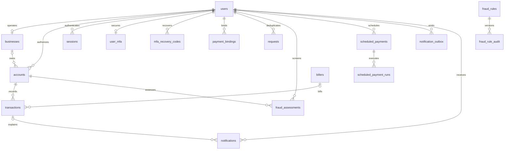

# PostgreSQL database

The active application uses PostgreSQL exclusively through [`db.js`](../db.js) and [`database/index.js`](../database/index.js). Express authentication, banking, fraud records and jobs all use the same transactional database. Python scores requests without database credentials. SQL migrations are the authoritative schema; no external cloud or container setup is required.

## Current local installation

| Setting | Value |
| --- | --- |
| PostgreSQL | 18.6 |
| Host / port | `127.0.0.1:55432` |
| Database / schema | `greenlink_dft` / `public` |
| Application login | `greenlink_app` |
| Migration login | `greenlink_owner` |
| Native server files | `.local/postgresql/` (ignored, not shipped) |
| Persistent data / server log | `data/postgresql/` / `data/postgresql.log` (ignored) |
| Schema | 25 tables, seven checksum-verified migrations |

At verification on 24 October 2026, the existing three users, three accounts and 11 transactions were retained. Balances reconcile with stored opening balances and completed ledger entries. The retired non-PostgreSQL stores have been removed after verifying a PostgreSQL backup in `data/backups/`. Only `data/postgresql` is active; the earlier stopped PostgreSQL cluster is an inactive reference copy. Existing business operators still need their own business profile and independent approval before financial writes.

```sh
npm run db:status
npm run db:start
npm run db:check
npm start
```

Stop the application with Ctrl+C before `npm run db:stop`. PostgreSQL persists independently of the web process. These helpers control only this project's `data/postgresql` cluster. If another PostgreSQL installation supplies the database, start/stop it through that installation instead.

## Set up a fresh checkout

Install Node.js 22.13+, PostgreSQL 16+ and the Python dependencies described in the [installation guide](installation.md). Native database binaries/data are deliberately excluded from the source package.

```sh
npm ci
npm run setup
```

Use an existing local PostgreSQL server, or initialize a project-owned cluster. Windows PowerShell example (choose the installed PostgreSQL version and your own administrator password when prompted):

```powershell
$env:POSTGRES_BIN = 'C:\Program Files\PostgreSQL\18\bin'
New-Item -ItemType Directory -Force data | Out-Null
& "$env:POSTGRES_BIN\initdb.exe" -D data/postgresql -U greenlink_dev -A scram-sha-256 -W --encoding=UTF8 --locale=C
npm run db:start
```

Run `initdb` only for a new, empty data directory. On macOS/Linux, point `POSTGRES_BIN` at the installed binary directory and use the equivalent `initdb` arguments. An existing service commonly uses port 5432; the project helper uses loopback port 55432 by default.

Copy [`database/admin.env.example`](../database/admin.env.example) to ignored `.env.database-admin`. Set its `ADMIN_DATABASE_URL` to your local administrator's maintenance database URL, using the correct port. Percent-encode special characters in URL passwords. Do not place real credentials in example files or commit them. Then:

```sh
npm run db:setup
npm run db:check
```

`db:setup` creates the named database if missing, applies the migrations and configures separate application/migration roles. Its default target is the database name in `.env` (`greenlink_dft` in the example); `DATABASE_NAME` can select another lowercase name. The administrator needs permission to create the database and roles and to adopt an existing Green Link Digital Bank schema. An unrelated populated target, unknown pre-existing role or elevated runtime/migration role is refused.

Setup saves randomly generated passwords privately; rerunning it reuses the saved credentials and preserves banking records. It does not seed, reset or overwrite users. Do not change the generated URLs to perform password rotation; coordinate a deliberate PostgreSQL role password change and matching configuration update instead. Database/role creation is not one PostgreSQL transaction; an interrupted setup may leave provisioned objects and saved credentials, which a retry can reuse.

For an empty sample database only, run `npm run db:seed`. Seeding is unnecessary on this machine's already populated database. The former import command has been retired.

## Credentials and SQL permissions

| File / role | Purpose |
| --- | --- |
| `.env`: `DATABASE_URL` / `greenlink_app` | Used by the web process; no superuser, database creation, role creation, replication or RLS-bypass privileges |
| `.env.database-admin`: `MIGRATION_DATABASE_URL` / `greenlink_owner` | Owns this database/schema; used only by migration/seed/staff administration commands |
| `.env.database-admin`: `ADMIN_DATABASE_URL` | Local bootstrap administrator, used only by `db:setup` |
| `.env.test`: `TEST_DATABASE_URL` | Separate test/maintenance database; never loaded by `npm start` |

The application can read banking tables and make the specific writes needed by its workflows. It cannot insert/update the `users.role` column, change opening balances, change recorded transaction amounts, delete ledger rows, rewrite/delete audit events or edit migration metadata. It has sequence usage without sequence reset. Public schema creation and public database access are revoked. Permission refresh also removes outdated column-level grants. Migration ownership remains privileged and must never be exposed through HTTP.

SQL restrictions complement Express ownership/RBAC checks; this is a shared service login, not per-customer PostgreSQL row-level security. Financial writes require authorization, eligibility checks, deterministic idempotency, locks and an atomic ledger/outbox transaction in the banking service.

For future schema changes, add a new numbered file under `database/migrations/`; never edit an applied file. Run `npm run db:migrate` before restarting the app. This command uses the migration role and refreshes runtime grants. Startup verifies migration checksums using the restricted login and reports a missing migration rather than requiring DDL rights.

Migration 006 corrects known historical demo login emails to the current project domain while preserving password hashes, customer IDs, roles and money. It revokes affected sessions and appends an audit event. It leaves unrelated identities unchanged and refuses a conflicting destination email. Historical SQL and audit metadata intentionally retain the previous identity values as provenance.

## Data model



| Tables | Responsibility |
| --- | --- |
| `users`, `businesses`, `accounts` | Hashed credentials, bank roles, registered entities, review status, business savings, legal ownership and integer-cent balances |
| `transactions`, `payment_bindings`, `requests` | Signed debit/credit ledger, pending/rejected lifecycle, immutable request binding and stored idempotent results |
| `billers` | Simulated supported bill-payment destinations |
| `sessions`, `auth_attempts` | Hashed session tokens, expiration/revocation and durable login/authorization quotas |
| `user_mfa`, `mfa_recovery_codes` | Encrypted authenticator secrets, replay counters and one-use hashed recovery codes |
| `fraud_assessments`, `fraud_settings`, `fraud_rules`, `fraud_rule_audit` | Bound historical/model inputs, explainable scores, current policy version and independent rule audit |
| `scheduled_payments`, `scheduled_payment_runs` | Recurrence, durable worker leases, retries and unique occurrence/receipt records |
| `notification_outbox`, `notifications` | Atomic outgoing events and deduplicated in-app delivery/read status |
| `audit_log` | Append-only application security/financial event records |
| `schema_migrations` | Installed migration names, normalized SQL checksums and timestamps |
| `legacy_imports`, `legacy_service_records` | Import provenance and archived historical records, never current payment authorization |

Foreign keys prevent orphaned records. Unique indexes protect normalized email, registration/account numbers, idempotency keys, settlement order and schedule occurrences. Check constraints enforce supported money ranges and transaction states. Account ownership is checked by the migration 005 trigger. Indexes support owned account/history reads, settled ledger statements, business review queues and due/outbox jobs. Historical imported accounts can have a null business link until legitimate onboarding; new registrations create a legal business link.

## Verify and inspect

`npm run db:check` verifies migrations, all expected tables, restricted-role controls and every account's opening balance plus completed ledger sum, inside one repeatable-read snapshot. It exits unsuccessfully on missing tables, ledger discrepancies or elevated runtime privileges. It prints no passwords, tokens or customer names.

For pgAdmin, register a server at `127.0.0.1`, port `55432`, database `greenlink_dft`. Use the private connection values in the relevant ignored file: runtime for ordinary reads, migration credentials for schema administration. Never include a credentials screenshot in your project submission.

Set `TEST_DATABASE_URL` in `.env.test` to a separate local test/maintenance database. Existing fixtures create/drop isolated schemas; PostgreSQL provisioning tests additionally create/drop uniquely named disposable databases and roles, so their test operator needs database/role creation privileges. Do not use the application login or a customer data database.

```sh
npm test
npm run test:browser
node --env-file=.env --env-file=.env.test scripts/platform-smoke.js
```

The provisioning tests verify fresh setup, repeat setup with retained data, restricted SQL failures, ledger drift detection, refusal of unrelated tables and real banking workflows through the restricted login. Containerisation, cloud database administration and deployment remain with DIT.

## Explicit feature-testing fixtures

`npm run test:accounts` adds dedicated synthetic users without replacing the original records. After the 2.6.0 walkthrough, this native database has 13 users, 7 business profiles, 13 savings records and 28 ledger rows; the original three users, three accounts and eleven ledger rows are unchanged. Runtime privileges and reconciliation still pass. Credentials and MFA material live privately in ignored `data/testing/`; see [feature walkthrough](feature-testing.md). The command verifies its owner/runtime connections target the same local database and schema before writing.

Migration 007 adds private agent run reports and append-only tool evidence. It changes no existing financial rows. See [banking agents](banking-agents.md) for retention and permissions.
